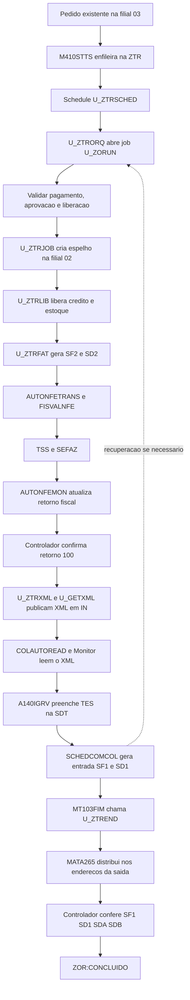

# Fluxo automatico de transferencia interfilial ZTR

## Objetivo e escopo

Documentacao tecnica e operacional do fluxo validado em homologacao em
29/10/2026, empresa 01, ambiente TOTVS_SUNTECH_TESTE. O pedido comercial nasce
na filial 03; o reabastecimento sai da filial 02, gera entrada na filial 03 e
reproduz os enderecos fisicos da saida.

O sistema real nao depende da API de inclusao de pedidos para este fluxo.
Nos testes, POST /orders foi apenas um gerador de pedidos, autorizado pelo
usuario. O ponto de integracao do processo e o pedido ja existente em SC5/SC6,
capturado pelo ponto de entrada M410STTS. RESTQry foi usado somente para leitura
das evidencias. Nao e necessario alterar a API Orders para executar a ZTR.

Escopo especifico implementado:

| Papel | Configuracao validada |
| --- | --- |
| Pedido de origem | Filial 03, tabela MKP, origem igual a MV_PEDTRAN |
| Filial abastecedora | 02 |
| Cliente do espelho | S00003/01 |
| Fornecedor da entrada | F02283/01, A2_FILTRF=02 |
| Pedido modelo TTR | 298377, definido em MV_ZTRMOD |
| Serie fiscal | 1, definida em MV_ZTRSER |
| TES de saida do modelo | 5F3, operacao 61, armazem 02 |
| TES de entrada | 1J2, definida em MV_ZTRTES |
| Identificador do espelho | ZR03 + numero do pedido de origem |

Esses valores nao sao uma parametrizacao fiscal universal. Alterar empresa,
filiais, cliente, fornecedor, TES, serie ou modelo exige revisar as validacoes
e as constantes dos fontes. O faturamento efetivo continua restrito por codigo
a ambientes cujo nome contenha TEST ou HOMOLOG.

## Visao geral



O desenho e assincrono. O controlador nao fica esperando a SEFAZ ou o
Importador dentro de uma unica transacao. A cada rodada, observa o banco e
retoma a etapa pendente. A criacao, a liberacao e o faturamento ocorrem em
rodadas separadas; a transmissao e o Monitor tem seus proprios agendamentos.
Nao ha garantia de processamento simultaneo das operacoes fiscais: a fila e
processada de forma controlada, mesmo que varios pedidos cheguem juntos.

## Fontes e funcoes

| Fonte | Entradas/funcoes principais | Responsabilidade |
| --- | --- | --- |
| [M410STTS.prw](../Fontes/SIGAFAT/PE/M410STTS.prw) | M410STTS, helpers de fila | Capturar pedidos elegiveis e proteger a solicitacao em alteracoes/exclusoes |
| [ZTRSCHED.prw](../Fontes/SIGAFAT/ZTRSCHED.prw) | U_ZTRSCHED, SchedDef, ZSClose | Entrada sem argumentos do Schedule, contexto e diagnostico |
| [ZTRORQ.prw](../Fontes/SIGAFAT/ZTRORQ.prw) | U_ZTRORQ, U_ZORUN, ZOROne, ZORAfter | Coordenar as etapas, alternar filiais em job isolado e acompanhar a fila |
| [ZTRORQ.prw](../Fontes/SIGAFAT/ZTRORQ.prw) | ZORItems, ZORProof, ZORAddr, ZORSave | Conferir itens/endereco/saldo e registrar o acompanhamento |
| [ZTRVALID.prw](../Fontes/SIGAFAT/ZTRVALID.prw) | U_ZTRVALID, ZTVCheck | Conferir a origem e atualizar sua elegibilidade |
| [ZTRVALID.prw](../Fontes/SIGAFAT/ZTRVALID.prw) | U_ZTRJOB, ZTRRun, ZTRMake, ZTRPrice, ZTRSaved | Criar e conferir o espelho com modelo TTR e identificador unico |
| [ZTRVALID.prw](../Fontes/SIGAFAT/ZTRVALID.prw) | U_ZTRLIB, ZTLCheck, U_ZTRFAT, ZTFPvl, ZTFDocs, ZTFProof, U_ZTRNFC | Liberacao, faturamento e comprovacao do documento de saida |
| [FISVALNFE.tlpp](../Fontes/SIGAFAT/FISVALNFE.tlpp) | U_FISVALNFE | Filtrar notas permitidas na transmissao automatica da filial 02 |
| [ZTRXML.prw](../Fontes/SIGAFAT/ZTRXML.prw) | U_ZTRXML, ZTXEntradaExiste, ZTXDir | Selecionar notas autorizadas vinculadas e publicar somente XML ainda pendente |
| [API's HB/GetXML.prw](../API's%20HB/GetXML.prw) | U_GETXML, _GetSf2RecnoByDoc, _UF_GERXML_LOCAL, _GetXmlFromTss | Recuperar XML do TSS e grava-lo no diretorio solicitado |
| [ZTRCOL.prw](../Fontes/SIGACOM/PE_IMPORTADOR/ZTRCOL.prw) | U_COMCOL2, U_COMCOLF4, U_A140IGRV, U_MT103FIM | Elegibilidade da entrada, TES e chamada pos-gravacao do enderecamento |
| [ZTREND.prw](../Fontes/SIGACOM/PE_IMPORTADOR/ZTREND.prw) | U_ZTREND, ZTEPlan, ZTEExec, ZTEConf, U_ZTRENSIM | Planejar, executar e conferir distribuicao pela MATA265 |

Rotinas padrao chamadas: MATA410 na criacao do espelho, MaLibDoFat na
liberacao, MaPvlNfs no faturamento e MATA265 no enderecamento. Os fontes
padrao de AutoNFe e Importador nao estao implementados nestes fontes ZTR.

## Separacao dos automatismos

- U_ZTRSCHED/U_ZTRORQ coordenam a fila; nao substituem TSS, SEFAZ ou Importador.
- AUTONFETRANS transmite notas elegiveis; a autorizacao nao e presumida a partir
  de uma mensagem de envio bem-sucedido.
- AUTONFEMON acompanha os retornos fiscais; a evidencia final usada pela ZTR
  e SF3.F3_CODRSEF=100, sem cancelamento, com chave NF-e valida na SF2.
- COLAUTOREAD/Monitor leem o XML e preparam os documentos do Importador.
- SCHEDCOMCOL efetiva a entrada conforme configuracao e pontos de entrada.
- MT103FIM e o controlador podem acionar U_ZTREND, mas o saldo e os movimentos
  existentes sao conferidos para evitar distribuicao repetida.

O nome de um semaforo no log, como autonfetrans ou autonfemon, nao define sozinho
os argumentos ou a periodicidade do agendamento. As configuracoes efetivas dos
automatismos padrao devem ser conferidas no Schedule do ambiente.

## Etapas detalhadas

### 1. Captura do pedido de origem

M410STTS trata inclusao/alteracao e exclusao. A rotina de fila exige filial 03,
tabela MKP, C5_ZZORIGE igual a MV_PEDTRAN e C5_PEDECOM preenchido. Grava uma
solicitacao por ZTR_FILORI + ZTR_PEDORI, com os identificadores comerciais em
ZTR_PEDEXT/ZTR_APIID. O espelho nao e criado dentro do ponto de entrada.

A origem exata que inclui o pedido comercial deve ser a integracao real do
sistema; nao se deve tornar a API de teste uma dependencia operacional.

### 2. Elegibilidade e fila

U_ZTRVALID/ZTVCheck conferem o pedido e os identificadores da solicitacao:

- C5_ZZSITFI=7: pagamento integral registrado no pedido.
- C5_ZZSITCO=1: aprovacao comercial.
- C5_LIBEROK=S: cabecalho liberado.
- Origem ainda sem NF e itens ativos, nao bloqueados.
- Quantidade pendente coberta por SC9 do mesmo produto, sem credito bloqueado
  ou nota fiscal; C9_BLEST vazio ou 02 e aceito na origem para reabastecimento.

Esses campos nao executam baixa financeira. O fluxo exige a condicao ja
registrada; nao cria recebimento nem contorna a validacao financeira.
Falta de estoque na origem pode motivar a transferencia, mas nao dispensa a
liberacao de estoque na filial abastecedora antes de seu faturamento.

### 3. Criacao e verificacao do espelho

U_ZTRJOB abre ambientes isolados 03 e 02, usa o modelo configurado e MATA410.
ZTRMake procura primeiro C5_ZZNPEXT=ZR03<pedido>. Se o espelho existe, confere
cabecalho e todos os itens em vez de criar outro. Um vinculo divergente e erro,
nao motivo para recriacao silenciosa.

O modelo deve ter tabela TTR, cliente S00003/01, origem INT, tipo TR, moeda 1,
TES/operacao/armazem preenchidos e uniformes nos itens. Cabecalho fiscal e
comercial sao derivados do modelo; produtos e quantidades sao os da origem.
Os precos vem da tabela TTR ativa, vigente, moeda 1 e faixa aplicavel, com uma
unica linha valida na ultima vigencia. Nao ha fallback para preco MKP.

A versao atual reserva C5_NUM por consulta do maior numero da filial 02,
semaforo proprio e verificacao antes de MATA410. Esse bloqueio coordena a ZTR,
nao todas as demais rotinas que possam criar pedidos na mesma filial. Nao
alterar numeracao ou vinculos por SQL para recuperar tentativas.

### 4. Liberacao do espelho

U_ZTRLIB valida novamente origem e espelho. Usa MaLibDoFat para avaliar credito
e estoque. ZTLCheck exige liberacao integral na SC9 do espelho, sem bloqueios e
sem nota. SC9 parcial ou bloqueada exige avaliacao pela rotina padrao; nao ha
estorno automatico para liberar um novo faturamento.

### 5. Faturamento

U_ZTRFAT seleciona liberacoes aptas, confere produtos, TES, saldo, condicao de
pagamento e preco e chama MaPvlNfs. Em modo automatico carrega MT460A sem tela;
seus parametros devem estar aprovados para o usuario/ambiente do agendamento.
ZTFDocs/ZTFProof comprovam a nota integral na SF2/SD2. Saidas parciais,
documentos multiplos ou divergencias impedem nova emissao automatica.

Gerar SF2/SD2 nao equivale a autorizar a NF-e. A proxima etapa e AG_NFE.

### 6. AutoNFe, TSS e autorizacao

| Funcao padrao | Papel | Cadastro recomendado para este fluxo |
| --- | --- | --- |
| AUTONFETRANS | Selecionar e transmitir NF-e ao TSS | Empresa 01, filial 02, serie 1; usar parametros da propria rotina |
| AUTONFEMON | Consultar/atualizar retorno de processamento fiscal | Mesmo ambiente, empresa/filial e serie fiscal da transmissao |
| AUTONFECANC | Processar cancelamento de NF-e | Fora da sequencia normal; nao e chamado pelo controlador ZTR |

No SIGACFG, acesse Ambiente -> Schedule -> Schedule -> Agendamentos -> Cadastro.
Antes de incluir, confira se a rotina ja esta agendada: nao duplique tarefas
existentes. Informe o nome padrao sem prefixo U_ e configure a tela de perguntas
oferecida pela propria rotina, incluindo Serie e Nro de Processos Simultaneos.
Nao transportar a assinatura de U_ZTRORQ para os automatismos padrao.

Segundo a documentacao TOTVS, 0 ou 1 processo simultaneo usa a thread principal;
2 ou mais habilitam processamento paralelo, com gerenciador e trabalhadores.
O Schedule ainda abre processos por empresa/filial selecionada. Comecar com
monothread e uma configuracao unica por escopo e uma recomendacao conservadora,
nao uma afirmacao sobre a configuracao atual de todos os Agents. Aumentar threads
exige avaliar licencas, recursos, sobreposicao e correcoes TOTVS de duplicidade.

O parametro padrao MV_QTDTRAN controla os dias retroativos de selecao da
AUTONFETRANS, limitado a 60 conforme TDN. Nao confundir essa janela com o
intervalo entre rodadas do Schedule. Conferir conteudo e tipo no ambiente antes
de alterar. Demais requisitos de certificado, entidade, serie e comunicacao TSS
devem ser validados pelo responsavel fiscal no configurador padrao.

#### Filtro customizado FISVALNFE

O PE retorna .T. sem restricao adicional quando nao esta na filial 02 ou nao
esta na pilha AUTONFETRANS. No escopo 02/AUTONFETRANS, exige:

- ParamIXB valido, operacao de saida S, filial 02, documento/serie preenchidos.
- Cliente S00003/01.
- SF2 existente e itens SD2 pertencentes a um unico pedido.
- Pedido vinculado a uma ZTR ativa 03 -> 02, estado CRIADO.
- Espelho TTR, origem INT, tipo TR e cliente/loja correspondentes.

Se falhar, retorna .F. e registra permitido=.F. em [ZTR NF-e].
**Impacto:** na filial 02, dentro desse automatismo, notas fora do recorte
permitido tambem sao recusadas pelo PE. Nao publicar esse filtro em producao
sem avaliar os outros processos de transmissao que usam o mesmo ponto de entrada.

O controlador espera SF3.F3_CODRSEF=100, F3_DTCANC vazio e chave com 44 posicoes.
Chave preenchida, F3_CODRET=T ou mensagem de transmissao nao bastam para concluir
autorizacao. Rejeicao, denegacao e cancelamento exigem tratamento fiscal; nao se
deve publicar XML para simular uma entrada autorizada.

### 7. Publicacao do XML

U_ZTRXML seleciona as notas autorizadas vinculadas ao pedido, usa UF_ENTTSS da
filial 02 e chama U_GETXML. O helper local usa WSNFeSBRA/RetornaNotas no TSS.
O identificador do documento no TSS preserva o padding de serie + numero.

O arquivo tem o formato arquivo_<serie><documento>.xml. Exemplo do teste:
arquivo_1000209489.xml. E gravado no diretorio MV_NGINN do AppServer, nao na
maquina do operador. A rotina nao deve sanitizar ou reescrever o XML assinado.

Se a entrada ou o arquivo em IN/LIDOS ja existe, contabiliza ignorados e nao
publica de novo. Retorno Publicados=1 comprova publicacao, nao importacao ou
entrada fiscal. Abertura da SF2 e feita por ChkFile e sua area e preservada.

### 8. Importacao e TES

COLAUTOREAD/Monitor leem o diretorio IN e registram o processamento. CKOCOL
mantem documento, arquivo, status e erros; SDS/SDT representam cabecalho/itens
intermediarios. U_A140IGRV aplica DT_TES com MV_ZTRTES depois da gravacao desses
itens, somente para transferencia elegivel da filial 03 com fornecedor da 02.

U_COMCOL2 sinaliza elegibilidade do fluxo; U_COMCOLF4 retorna a TES configurada
no momento da geracao da entrada. SCHEDCOMCOL e o mecanismo padrao responsavel
pela efetivacao conforme configuracao do Monitor. Nao substitui-lo por INSERT
em SF1/SD1 nem reimportar XML para tentar corrigir uma entrada ja existente.

Estado de sucesso em CKOCOL ou DT_TES preenchida nao prova a existencia da
entrada fiscal: a comprovacao exige SF1/SD1 ativos e a mesma chave fiscal.

### 9. Enderecamento e comprovacao

MT103FIM reage a inclusao confirmada, filial 03, com MV_ZTREND logico .T. e
chama U_ZTREND. Se o PE nao executar, o controlador pode recuperar a etapa
pendente em outra rodada. Em ambos os caminhos sao usadas as mesmas validacoes.

U_ZTREND associa SF1/SF2 pela chave fiscal, SD1/SD2 por item/produto/lote e
recupera na SDB da filial 02 o endereco e a quantidade reais da saida. Confere
SBE no armazem de entrada da filial 03. Nao usa o endereco padrao do produto
como substituto de uma origem nao encontrada.

ZTEExec abre a SDA se necessario, executa MATA265 no contexto de Estoque
(nModulo=4), restaura o modulo e exige comprovacao SQL de SDA sem saldo e SDB
compativel com o plano antes e depois do fechamento da transacao. Mais de um
endereco por item conserva a divisao das quantidades da saida.

Restricoes: saldo SDA parcial, endereco ausente, origem ambigua, quantidades
divergentes ou marcacao de integracao WMS sao recusados. O fluxo nao implementa
uma alternativa automatica para esses casos. Sem saldo pendente nao gera nova
distribuicao; o controlador ainda compara a distribuicao efetiva para concluir.

## Parametros e valores

Valores abaixo conferidos por leitura de SX6 em 29/10/2026, nao alterados por
esta documentacao. Os controles ZTR sao lidos na filial 03; o publicador e o TSS
operam no contexto 02. Filial em branco indica cadastro compartilhado.

| Parametro | Tipo SX6 | Padrao do codigo | Valor observado | Finalidade/contexto |
| --- | --- | --- | --- | --- |
| MV_PEDTRAN | C | Vazio, obrigatorio | B2C | Origem comercial elegivel na filial 03 |
| MV_ZTRAUT | L | .F. | .T. | Efetivacao da entrada do Schedule; .F. apenas simula |
| MV_ZTRMOD | C | Vazio | 298377 | Modelo TTR da filial 02; obrigatorio para criar novos espelhos |
| MV_ZTRSER | C | Vazio | 1 | Serie usada para faturar na filial 02 |
| MV_ZTRFAT | L | .F. | .T. | Habilitacao adicional do faturamento automatico, mantendo restricao de ambiente |
| MV_ZTRMAX | N | 5 | 5 | Inteiro positivo; limite do contador ZTR_TENTAT |
| MV_ZTRTES | C | Vazio | 1J2 | TES da entrada/importacao e filtro da comprovacao |
| MV_ZTREND | L | .F. | .T. | Habilitar chamada imediata de enderecamento pelo MT103FIM |
| MV_NGINN | C | Vazio, obrigatorio | `\importadorxml\inn` | Diretorio de publicacao/leitura XML no servidor |
| MV_NGLIDOS | C | Vazio, obrigatorio | `\importadorxml\lidos` | Diretorio de arquivos lidos, usado para nao republicar |
| UF_ENTTSS | C | Dependente da filial | Filial 02: 000041 | Entidade TSS emissora usada pelo GETXML |
| MV_SPEDURL | C | Fallback http:// no helper, nao operacional | http://tss-homologacao.totvscloud.com.br:8261 | Endereco do TSS do ambiente; nao copiar para producao |
| MV_QTDTRAN | N, parametro padrao TOTVS | Ver configuracao padrao TOTVS | 60, compartilhado | Janela retroativa da AUTONFETRANS, ate 60 dias conforme TDN |

UF_ENTTSS tambem foi encontrado com 020042 na filial 01 e 054499 na 03. Esses
valores pertencem a outras entidades: o XML da transferencia emitida pela 02
usa 000041. Nao trocar entidades para contornar erro de consulta de XML.

Cadastre em SIGACFG -> Ambiente -> Cadastros -> Parametros. L e logico, N e
numerico, C e caractere. Um parametro C contendo o texto .T. continua sendo
caractere e e recusado pelos controles logicos. O limite numerico deve ser
inteiro positivo. Caso haja valor por filial, conferir a precedencia sobre o
registro compartilhado. Apos alteracoes, considerar o cache do Agent e validar
o tipo/valor efetivamente lido no log antes de operar.

## Agendamentos e implantacao

### Fontes a publicar

Conferir e compilar no mesmo ambiente/RPO acessado pelos Agents:

1. M410STTS, no fonte do PE relacionado na matriz.
2. ZTRVALID, ZTRORQ e ZTRSCHED.
3. FISVALNFE, apos avaliar seu impacto sobre a transmissao da filial 02.
4. ZTRXML e o fonte que fornece U_GETXML.
5. ZTRCOL e ZTREND.

A tabela ZTR e seus campos/indices devem existir antes da ativacao. A evolucao
do controlador nao criou novos estados fisicos ou campos de dicionario; reutiliza
os existentes. Padrao TOTVS, bibliotecas e servicos TSS sao pre-requisitos, nao
substituidos pela compilacao desses fontes customizados.

Uma checagem de diagnosticos do VS Code nao e compilacao no RPO. Validar tambem
se todas as instancias do ambiente carregam a mesma versao dos fontes.

### Cadastro de U_ZTRSCHED

No SIGACFG -> Ambiente -> Schedule -> Schedule:

1. Confirmar Agent habilitado, ambiente correto e acesso ao RPO atualizado.
2. Incluir agendamento com Rotina = U_ZTRSCHED, sem parenteses ou argumentos.
3. Selecionar empresa 01 e somente filial 03.
4. Usar usuario autorizado a trabalhar nas filiais 03 e 02, inclusive fiscal/estoque.
5. Configurar recorrencia sugerida de 1 minuto e data/hora de inicio.
6. Nao usar Sempre Ativo nem cadastrar outra copia para filial 02.
7. Testar inicialmente com MV_ZTRAUT=.F.; conferir os logs antes de habilitar .T.

SchedDef retorna processo P, sem grupo de perguntas, permitindo selecionar
filiais e sem permitir Sempre Ativo. O proprio Schedule inicializa o ambiente.
U_ZTRSCHED registra ambiente, empresa, filial, SX6 e tipo de MV_ZTRAUT; recusa
contexto incompleto ou filial diferente de 03. Usa lote de 20 solicitacoes.

Nao agendar U_ZORUN diretamente, pois exige job isolado. Nao colocar a expressao
U_ZTRORQ("01",...) no campo Rotina: essa assinatura e de chamada manual.

### Matriz de servicos

| Servico | Empresa/filial do recorte | Dependencia | Periodicidade |
| --- | --- | --- | --- |
| U_ZTRSCHED | 01/03 | Pedido elegivel e fila ZTR | Sugerida 1 minuto; lote 20 |
| AUTONFETRANS | 01/02, serie 1 | NF gerada e filtro FISVALNFE aprovado | Conferir cadastro nativo no ambiente |
| AUTONFEMON | 01/02, serie 1 | Documento enviado ao TSS | Conferir cadastro nativo no ambiente |
| COLAUTOREAD/Monitor | Contexto de importacao da filial 03 | XML no diretorio configurado | Conferir cadastro do Importador |
| SCHEDCOMCOL | 01/03 | Documento preparado no Monitor | Conferir cadastro do Importador |

O controlador nao cadastra, inicia ou substitui esses agendamentos padrao. Os
testes mostraram esperas de varios minutos entre alguns marcos; isso nao
comprova, sozinho, qual e o intervalo configurado em cada tarefa. Registrar as
recorrencias efetivas em exportacao ou captura da tela do Schedule para a operacao.

Antes de habilitar faturamento, revisar MT460A e serie fiscal com o responsavel.
Antes de habilitar leitura/entrada, revisar TES, fornecedor interfilial e pastas.
Nao reduzir intervalos ou aumentar processos paralelos apenas com base no tempo
total observado: primeiro distinguir espera de agendamento, TSS/SEFAZ, filas,
leitura XML, classificacao e distribuicao.

## Estado da fila e bloqueios

### Estado fisico ZTR_STATUS

| Estado | Significado e comportamento |
| --- | --- |
| AG_PGTO | Aguardando pagamento integral da origem |
| AG_LIB | Aguardando aprovacao/liberacao suficiente da origem |
| PRONTO | Origem apta para criacao do espelho |
| CRIANDO | Criacao iniciada; interrupcao exige conferir espelho antes de recuperar |
| CRIADO | Espelho vinculado; acompanha fiscal, entrada e enderecamento |
| ERRO_REP | Falha de reposicao; exige conferencia/recuperacao manual |
| ERRO_MAN | Divergencia que exige analise manual |
| CANCELADO | Estado protegido, nao selecionado automaticamente |

O lote automatico seleciona apenas AG_PGTO, AG_LIB, PRONTO e CRIADO, ordenados
por ZTR_DTATU, ZTR_HRATU e recno, com ZTR_TENTAT menor que MV_ZTRMAX. Estados
inconsistentes, CRIANDO/ERRO_REP e registros excluidos nao sao recriados pelo job.

### Acompanhamento em ZTR_MSGERR

| Marcador/etapa | Significado |
| --- | --- |
| ZOR:CRIADO | Espelho confirmado e vinculado |
| ZOR:AG_LIB02 | Liberacao da filial 02 ainda pendente no contexto avaliado |
| ZOR:LIBERADO | Liberacao integral conferida; faturamento em rodada seguinte |
| ZOR:AG_FAT | Aguarda faturamento, inclusive quando MV_ZTRFAT esta desabilitado |
| ZOR:AG_NFE | Aguarda autorizacao, chave valida e ausencia de cancelamento |
| ZOR:AG_ENTRADA | XML publicado/existente; aguarda Monitor e entrada |
| ZOR:AG_ENDER | Simulacao identificou entrada a enderecar |
| ZOR:CONCLUIDO | Documentos, itens, saldo e distribuicao conferidos no banco |
| ZOR:ERRO_* | Falha com etapa e mensagem; analisar antes de repetir |

Os marcadores de espera da origem podem ser ZOR:AG_PGTO/ZOR:AG_LIB. Nomes de
erros seguem a etapa, por exemplo ERRO_XML, ERRO_ENTRADA, ERRO_ENDER e ERRO_FILA;
nao sao novos conteudos de ZTR_STATUS.

**Concluido continua com ZTR_STATUS=CRIADO.** A selecao exclui mensagens com
prefixo ZOR:CONCLUIDO seguido de espaco. Isso preserva contratos das rotinas
existentes, inclusive o filtro de transmissao, sem executar tudo novamente.
ZTR_MSGERR tambem guarda acompanhamento normal; mensagem nao vazia nao significa
necessariamente erro. Esperas normais nao incrementam tentativas.

ZTR_TENTAT inclui tentativas de criacao e falhas posteriores. Ao atingir o limite,
a solicitacao deixa de ser selecionada mesmo que o estado seja CRIADO. Nao zerar
o contador por SQL nem aumentar o limite global para mascarar um erro recorrente.

### Concorrencia e idempotencia

- Semaforo por empresa impede rodadas sobrepostas do controlador.
- Semaforos por solicitacao protegem acompanhamento e acoes de criacao/liberacao/faturamento.
- Identificador ZR03<pedido> e conferencia de cabecalho/itens evitam duplicar espelho.
- Conferencia SF2/SD2 evita refaturar um espelho com documento existente.
- Existencia da entrada e de arquivos IN/LIDOS evita republicacao desnecessaria.
- Saldo SDA, movimentos SDB e conferencia dos enderecos impedem considerar uma
  nova distribuicao como necessaria quando o documento ja esta atendido.

LockByName coordena conforme servidor de licencas/semaforos e SpecialKey do
ambiente. Verificar configuracao consistente entre instancias; nao presumir que
semaforos locais isolados protegem todos os servidores. Nao apagar arquivos de
semaforo manualmente com jobs ativos.

Essas protecoes coordenam a ZTR e seus documentos. Nao tornam todas as integracoes
externas ou operacoes MATA410 imunes a lock, nem provam que um timeout HTTP
significou rollback. Aguardar/conferir pelo identificador antes de repetir qualquer
inclusao feita por um gerador de teste ou pela integracao real.

## Conferencia no banco e logs

### Tabelas e evidencias

| Tabela | Evidencia |
| --- | --- |
| SC5/SC6 origem | Pedido, identificadores, pagamento/aprovacao e itens |
| SC9 origem | Quantidade liberada e bloqueios aceitos para reposicao |
| ZTR | Vinculo origem/espelho, estado, mensagem, tentativas e horarios |
| SC5/SC6/SC9 espelho | Configuracao TTR e liberacao antes do faturamento |
| SF2/SD2 | Cabecalho/itens integrais da nota de saida e sequenciais |
| SF3 | Autorizacao 100 e ausencia de cancelamento |
| CKOCOL | Processamento XML, arquivo, retorno/importacao e erros |
| SDS/SDT | Documento intermediario no Monitor e DT_TES |
| SF1/SD1 | Entrada efetiva, chave, fornecedor, produtos, quantidades e D1_TES |
| SDA | Quantidade original e saldo a enderecar |
| SDB | Movimentos por endereco, quantidades, sequencial e estorno |
| SBE | Cadastro do mesmo endereco no armazem da filial destino |
| DA0/DA1 | Tabela/preco TTR vigente e sem ambiguidade |

Filtrar registros ativos com D_E_L_E_T_=' '. Para investigar historico, separar
explicitamente os excluidos com D_E_L_E_T_='*'. Nao contar registros de releituras
excluidos logicamente como duplicidades ativas. O RESTQry omite D_E_L_E_T_ do
JSON mesmo quando selecionado: o filtro/COUNT e a evidencia do estado.

Os exemplos abaixo sao exclusivamente SELECT. O sufixo fisico 010 pertence ao
ambiente validado; conferir RetSqlName/dicionario em outro ambiente. No RESTQry,
ORDEM deve ser nome de coluna, nao indice 1, pois a paginacao usa ROW_NUMBER.

```sql
SELECT ZTR_PEDORI, ZTR_PEDTRF, ZTR_STATUS, ZTR_TENTAT,
       ZTR_MSGERR, ZTR_DTATU, ZTR_HRATU
FROM ZTR010
WHERE ZTR_FILORI = '03' AND ZTR_FDEST = '02'
  AND ZTR_PEDORI IN ('005953', '005954') AND D_E_L_E_T_ = ' '
```

```sql
SELECT F3_NFISCAL, F3_SERIE, F3_CODRSEF, F3_CODRET, F3_DTCANC
FROM SF3010
WHERE F3_FILIAL = '02' AND F3_NFISCAL IN ('000209490', '000209491')
  AND F3_SERIE = '1' AND F3_CLIEFOR = 'S00003' AND F3_LOJA = '01'
  AND D_E_L_E_T_ = ' '
```

```sql
SELECT D1_FILIAL, D1_DOC, D1_SERIE, D1_ITEM, D1_COD,
       D1_QUANT, D1_TES, D1_LOCAL, D1_NUMSEQ
FROM SD1010
WHERE D1_FILIAL = '03' AND D1_DOC IN ('000209490', '000209491')
  AND D1_SERIE = '1' AND D1_FORNECE = 'F02283' AND D1_LOJA = '01'
  AND D_E_L_E_T_ = ' '
```

```sql
SELECT DA_DOC, DA_PRODUTO, DA_LOCAL, DA_NUMSEQ, DA_QTDORI, DA_SALDO
FROM SDA010
WHERE DA_FILIAL = '03' AND DA_DOC IN ('000209490', '000209491')
  AND DA_SERIE = '1' AND DA_CLIFOR = 'F02283' AND DA_LOJA = '01'
  AND D_E_L_E_T_ = ' '
```

```sql
SELECT DB_FILIAL, DB_DOC, DB_SERIE, DB_PRODUTO, DB_LOCAL,
       DB_LOCALIZ, DB_NUMSEQ, DB_QUANT, DB_ESTORNO
FROM SDB010
WHERE DB_FILIAL IN ('02', '03') AND DB_DOC IN ('000209490', '000209491')
  AND DB_SERIE = '1' AND D_E_L_E_T_ = ' '
```

Comparar enderecos por sequencial/produto/lote, nao apenas pelo numero da NF.
No destino, usar D1_NUMSEQ; na origem, D2_NUMSEQ. Numeros de documentos podem
repetir entre filiais, clientes e series. Conferir sempre a chave e o vinculo do
pedido espelho, e nao somar estornos como movimentos normais.

### Prefixos de log

| Prefixo | Uso |
| --- | --- |
| [ZTRSCHED] | Contexto recebido, tipo MV_ZTRAUT, modo e resumo |
| [ZTRORQ] | Pedido, etapa e resultado do lote |
| [ZTR] | Validacao, abertura de ambientes e criacao do espelho |
| [ZTR NF-e] | Decisao do FISVALNFE para transmissao |
| [ZTRXML] | Abertura SF2, publicacao, ignorados e falhas |
| [GETXML][TSS] | Localizacao da nota e retorno do servico XML |
| [ZTRCOL] | Decisao de elegibilidade e TES no Importador |
| [ZTREND][MT103FIM] | Chamada imediata apos inclusao da entrada |
| [ZTREND][MATA265] | Inicio/retorno da distribuicao |
| [ZTREND][CONFIRMA] | Comprovacao SQL de SDA/SDB |

Consultar logs de todas as instancias que atendem o ambiente: Schedule, acesso
exclusivo e REST podem executar em servidores diferentes. Conferir LastWriteTime
dos arquivos exportados; ausencia de mensagem em arquivo antigo nao comprova
ausencia de execucao. Preservar .bak quando houver rotacao.

### Checklist de conclusao

1. Uma origem e um espelho correspondentes, sem duplicacao do identificador.
2. Uma saida integral vinculada ao espelho, com todos os produtos/quantidades.
3. Nota autorizada 100, sem cancelamento e com chave fiscal valida.
4. Uma entrada ativa no destino com a mesma chave e fornecedor correto.
5. SD1 com todos os produtos/quantidades/lotes e TES configurada.
6. SDA sem saldo a distribuir para todos os sequenciais da entrada.
7. SDB sem estorno com as quantidades e enderecos reais da saida.
8. Acompanhamento ZOR:CONCLUIDO; rodadas seguintes sem reprocessar o pedido.

## Operacao manual e recuperacao

Chamadas de conferencia nao substituem o Schedule. Primeiro verificar parametros,
permissoes e documento existente. Exemplos sem gravacao, pela empresa 01/03:

```advpl
U_ZTRORQ("01", Nil, Nil, .F., 20)
U_ZTREND("000209488", "1", "F02283", "01", .F.)
```

Nil em modelo/serie manda o controlador ler MV_ZTRMOD/MV_ZTRSER; string vazia
explicita nao equivale a Nil. Sem argumentos U_ZTRORQ usa a empresa da sessao
e simula. U_ZTRSCHED, ao contrario, respeita MV_ZTRAUT e pode efetivar: nao usar
essa entrada como se fosse uma simulacao manual garantida.

U_ZTRENSIM oferece formulario sem argumentos e sempre simula. U_ZTRPROC oferece
criacao manual por pedido/modelo, com confirmacao para efetivar. U_ZTRLIB e
U_ZTRFAT mantem modo interativo sem argumentos; com parametros sao usados pelo
controlador sem telas. Nao efetivar essas etapas manualmente para acelerar um
teste que pretende validar justamente o agendamento automatico.

U_ZTRREC e especifica para recuperar status vazio para ERRO_REP, depois de
conferir a ausencia de espelho. Nao e um reset generico de tentativas, nao
reabre automaticamente concluidos e nao cancela documentos fiscais.

| Sintoma | Verificacao/acao segura |
| --- | --- |
| MV_ZTRAUT tipo C | Corrigir cadastro para L; texto .T. em C nao e logico; conferir cache do Agent |
| Schedule sem ambiente/filial errada | Conferir U_ZTRSCHED/SchedDef compilado e cadastro 01/03 |
| processados=0, falhas=0 | Conferir se ha elegiveis; concluidos/limite/estados protegidos ficam fora da selecao |
| AG_PGTO/AG_LIB | Conferir origem, pagamento, aprovacao e SC9; nao liberar apenas por SQL |
| Modelo/preco TTR ausente ou ambiguo | Corrigir cadastro pelo processo comercial/fiscal e revalidar |
| AG_NFE com chave ou CODRET=T | Ainda exigir retorno 100; verificar AUTONFETRANS, AUTONFEMON e TSS |
| permitido=.F. em FISVALNFE | Conferir escopo, ParamIXB, vinculo ZTR/espelho e cabecalho/itens |
| ERRO_XML/SF2 indisponivel | Conferir fonte corrigido, abertura por ChkFile e instancia/RPO do job |
| AG_ENTRADA, arquivo ignorado | Conferir IN/LIDOS, CKOCOL/SDS/SDT e SCHEDCOMCOL; nao publicar repetidamente |
| TES preenchida sem SF1/SD1 | Documento ainda no Monitor; conferir efetivacao da entrada |
| SDA parcial, endereco ausente, WMS ou divergencia | Interromper e tratar pela rotina padrao; nao forcar MATA265 |
| Log OK e banco divergente | Priorizar evidencias SF1/SD1/SDA/SDB; conferir versao com validacao SQL |
| Limite de tentativas atingido | Pausar somente o agendamento do fluxo afetado, analisar documentos e corrigir causa antes de retomar |
| Timeout na inclusao usada no teste | Recuperar por identificador na SC5/ZTR e conferir logs antes de reenviar |

Se a origem for excluida, M410STTS so exclui logicamente a fila quando nao existe
espelho, nao houve tentativa e o estado e AG_PGTO/AG_LIB/PRONTO. Caso contrario,
preserva o historico e sinaliza conferencia manual. Nao cancela automaticamente
espelho, NF, entrada ou estoque. Cancelamentos/rejeicoes posteriores a conclusao
e correcoes de distribuicao exigem processo proprio; limpar ZOR:CONCLUIDO nao e
uma rotina de estorno.

Quando houver suspeita de duplicidade ou falha recorrente, pausar apenas o
agendamento envolvido, preservar logs e conferir registros ativos/excluidos.
Nao parar indiscriminadamente os Agents de outros processos. Nao executar
UPDATE/DELETE/INSERT em documentos ou contadores para fazer o fluxo aparecer
como concluido. A retomada deve preservar pedido, espelho e nota existentes.

## Contratos de chamada das funcoes customizadas

| Funcao | Contexto e parametros | Retorno principal |
| --- | --- | --- |
| U_ZTRSCHED() | Schedule inicializado na filial 03; sem argumentos; modo por MV_ZTRAUT | {sucesso, resumo, resultadosPorPedido} |
| U_ZTRORQ(cEmpresa,cModelo,cSerie,lEfetiva,nLimite) | Chamada manual ou entrada Schedule; simula se lEfetiva nao for logico; limite 1 a 100 | {sucessoDoLote, resumo, resultadosPorPedido} |
| U_ZORUN(...) | Exclusivamente job isolado iniciado pelo controlador | Mesmo contrato do lote |
| U_ZTRVALID(lGrava,cPedidoFiltro) | Filial 03; valida origem, com filtro opcional por pedido | Array de {pedido, estado, mensagem} |
| U_ZTRJOB(cEmpresa,cPedido,cModelo,lGrava) | Job isolado, nao chamada direta em ambiente ja aberto | {sucesso, estado, espelho, mensagem} |
| U_ZTRLIB(cPedido,lGrava) | Filial 02; parametros para modo sem tela | {sucesso, mensagem, liberacaoIntegral} |
| U_ZTRFAT(cPedido,cSerie,dEntrega,lGrava) | Filial 02; parametros para modo sem tela; restricao teste/homologacao | {sucesso, mensagem, documento, serie} |
| U_ZTRNFC(cPedido) | Filial 02; confere o vinculo e a nota sem faturar | {sucesso, etapa, mensagem, documento, serie, chave} |
| U_ZTRXML(cPedido,lDetalhe) | Filial 02; cPedido restringe selecao; lDetalhe=.T. para o controlador | {sucesso, mensagem, publicados, ignorados, falhas}; modo legado retorna numero de publicados |
| U_GETXML(cDoc,cSerie,cDir,cIdEnt,lRetXml) | SF2 aberta e entidade da filial emissora; lRetXml=.F. grava arquivo | {sucesso, caminhoOuMensagem}; com .T. devolve XML em memoria |
| U_ZTREND(cDoc,cSerie,cFornec,cLoja,lEfetiva) | Filial 03; simula por padrao; .T. pode movimentar estoque | {sucesso, mensagem, plano} |
| U_ZTRENSIM() | Formulario, filial 03, exclusivamente simulacao | Resultado exibido em tela |

U_ZTRLIB/U_ZTRFAT sem parametros mantem suas telas manuais. O formato de retorno
parametrizado nao deve ser presumido para a chamada interativa. A lista do lote
tem entradas {pedido, sucesso, etapa, mensagem}; o resumo pode ter sucesso=.F.
se um pedido falhou, enquanto os demais continuam sendo conferidos.

## Evidencias de homologacao e tempos

Testes executados em 29/10/2026, sem extrapolar a validacao para producao:

| Origem 03 | Espelho 02 | NF/serie | Escopo | Resultado no banco |
| --- | --- | --- | --- | --- |
| 005950 | 298378 | 000209487/1 | Um produto; depuracao da publicacao XML | Concluido as 11:34:08, TES 1J2, SDA=0, SDB=1 em G18D |
| 005951 | 298379 | 000209488/1 | Um produto, medicao sem intervencao nas etapas | Concluido as 12:11:13, aproximadamente 15 min 21 s |
| 005952 | 298380 | 000209489/1 | Dois produtos no mesmo pedido | Concluido as 12:41:16, aproximadamente 12 min 23 s |
| 005953 | 298382 | 000209491/1 | Disparo concorrente, cliente C30156/03, dois produtos | Concluido as 13:26:30, aproximadamente 15 min 15 s |
| 005954 | 298381 | 000209490/1 | Disparo concorrente, cliente C07896/01, dois produtos | Concluido as 13:26:26, aproximadamente 15 min 11 s |

Nos dois ultimos pedidos, foram conferidos quatro itens: quantidade 1 cada,
TES 1J2, SDA zero e SDB sem estorno em G18D para 10105560149001 e H13B para
10100020243024, local 02. Os dois ficaram com tentativa 1 e ZOR:CONCLUIDO.

Exemplo cronometrado 005951:

| Marco | Horario (-03:00) |
| --- | --- |
| Envio do gerador de teste | 11:55:52.004 |
| Resposta de inclusao | 11:56:03.059; duracao monotonica 11,054 s |
| Espelho confirmado pelo controlador | 11:56:37.587583 |
| Liberacao confirmada | 11:57:31.573864 |
| Documento de saida confirmado | 11:58:50.757847 |
| Inicio da transmissao | 12:00:37.951112 |
| Retorno XML registrado no CKOCOL | 12:06:28 |
| Importacao registrada no CKOCOL | 12:10:30 |
| Acompanhamento concluido na ZTR | 12:11:13 |

O total inclui latencias de Schedule, TSS/SEFAZ, leitura do XML, classificacao e
confirmacao. Nao representa apenas tempo de CPU. Retorno CKOCOL nao e o horario
exato da autorizacao; importacao CKOCOL nao e, por si so, o instante de gravacao
SF1/SD1. Marcadores da ZTR tem precisao de segundos e sao sobrescritos nas rodadas.
Guardar os logs de transicao para medir cada subetapa sem inferencias.

### Problemas encontrados e limites do teste

- Alias SDA ausente: corrigido por abertura pelo dicionario; sucesso passou a
  exigir confirmacao SQL e execucao de todos os itens.
- Alias SF2 ausente na publicacao: corrigido por ChkFile, preservando a area do
  chamador e levando a causa ao retorno gravado na ZTR.
- Parametro logico cadastrado como C: identificado no log e corrigido no cadastro.
- Duas inclusoes pelo gerador usando o mesmo cliente: uma terminou com timeout
  e erro MATA410 A410NAOREG; o log registrou espera por lock SA1. Nao comprova
  falha de concorrencia no orquestrador, pois a outra requisicao nem chegou a fila.
- Na repeticao com clientes distintos, ambos os pedidos persistiram e concluiram,
  mas uma resposta HTTP ainda expirou. Nao confundir timeout com ausencia de
  gravacao nem declarar desempenho HTTP aprovado apenas pelo sucesso final.
- Ocorrencias de duplicidade DHY/DHZ/CKOCOL e falha ao liberar semaforo AutoNFe
  apareceram nos logs. Os documentos citados foram conferidos no banco; isso
  nao dispensa investigar separadamente os erros padrao ou agendamentos sobrepostos.

Detalhes e identificadores dos testes:

- [Linha do tempo 005951](../tests/api_hb/ztr_fluxo_005951.md).
- [Lotes com multiplos itens e clientes](../tests/api_hb/ztr_concorrencia_20261029.md).
- [Configuracao dos testes/API](../tests/api_hb/README.md).

O teste comprovou um recorte especifico de clientes, produtos, TES, serie e
enderecos em homologacao. Nao cobriu automaticamente todos os lotes, numeros
de serie, WMS, saidas parciais, rejeicoes/cancelamentos, filiais alternativas ou
volume de producao. O filtro FISVALNFE e a restricao de ambiente do faturamento
devem ser revisados antes de qualquer planejamento de implantacao produtiva.

## Referencias oficiais

- [AutoNFe: monothread e multithread](https://tdn.totvs.com/pages/viewpage.action?pageId=621589657).
- [Janela retroativa de transmissao, MV_QTDTRAN](https://tdn.totvs.com/pages/viewpage.action?pageId=558238817).
- [Definicoes SchedDef](https://tdn.totvs.com/pages/viewpage.action?pageId=36800166).
- [Configuracao de Schedule e Agent](https://tdn.totvs.com/pages/viewpage.action?pageId=778774965).
- [MATA265: rotina automatica de enderecamento](https://tdn.totvs.com/pages/releaseview.action?pageId=6087464).
- [MT103FIM: operacao apos gravacao da entrada](https://tdn.totvs.com/pages/viewpage.action?pageId=6085406).
- [LockByName e escopo dos semaforos](https://tdn.totvs.com/pages/viewpage.action?pageId=6814894).

Referencias consultadas para orientar a documentacao; sempre confrontar com a
LIB, release, pacotes e configuracao efetiva do ambiente. Este levantamento
alterou somente documentacao e realizou consultas de leitura de parametros;
nao criou novos pedidos, nao recadastrou agendamentos e nao alterou dados fiscais.